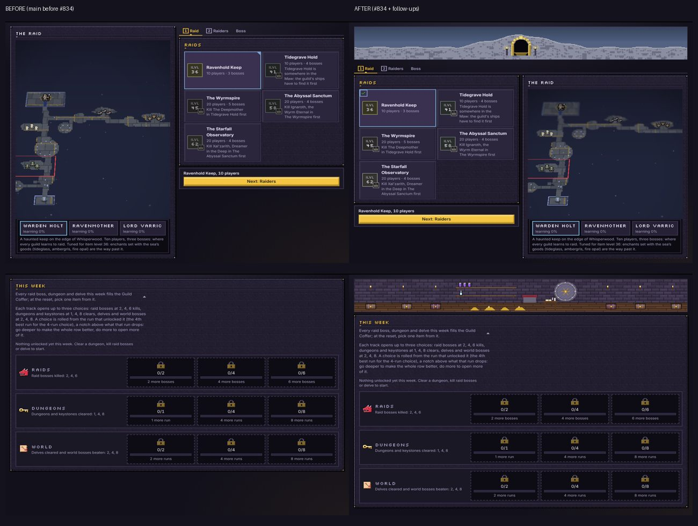
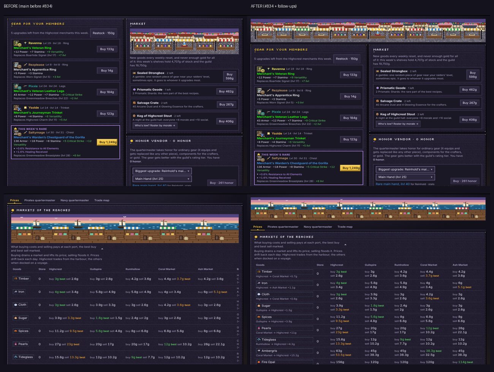
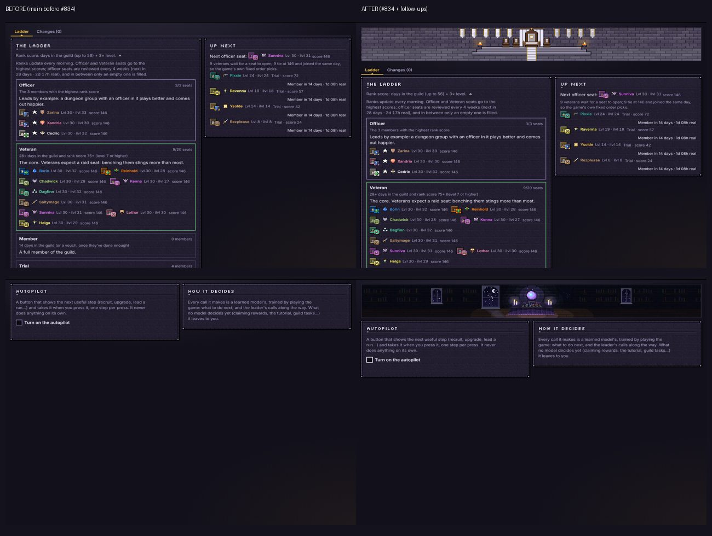
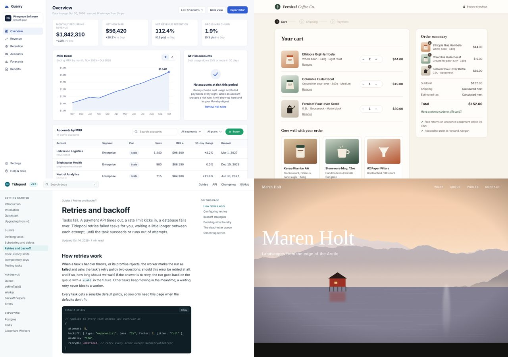

# Field test: critique verifies the previous run (#1264)

Evidence for the `critique-converges` branch of this fork. Nothing here is part of the change itself.

## The problem, as it happened

[Raid Leader Simulator](https://github.com/highnet/raid-leader-simulator) is a React and PixiJS management game. We redesigned 14 of its app screens around one design language, then ran `critique` three times, fixing every priority issue between runs. Each run used two isolated sub-agents (A and B), as `critique.md` requires. The score was 28/40 all three times, with H4 and H8 at 2 and every other heuristic at 3. Each fresh reviewer found new issues in place of the fixed ones, and some contradicted the previous run. Nothing in the report could say whether the work was converging.

Before and after the redesign (screens from the game, 1280×900):

## What the branch changes

- **Assessment A is unchanged and stays blind.** It never sees a previous run. It now also states, for each heuristic under 4, the bar for its next point: one checkable change.
- **Assessment C (new) verifies the previous run.** It is an isolated sub-agent that receives only the previous Priority Issues and Next Point bars. It marks each one fixed, partly fixed, not fixed or no longer applies, with evidence. It never scores, ranks or raises issues. It credits only a change it can name, confirmed in the source as well as on screen.
- **A "Since the Last Run" section in the report.** It covers:
  - prior issues fixed and bars met;
  - a goalpost check: when a met bar's score held, the run says whether the new issue is a regression or was there all along, decided from `git diff <target_commit>`, not from the clock;
  - reversals: a finding that would undo a verified fix becomes a question, and stays one until the user answers;
  - an explicit convergence call.
- **Documented intent:** a pattern that PRODUCT.md or DESIGN.md records as a decision is raised as a question, not deducted.
- **Engine:** `critique-storage previous <target> [--json]` reads the newest run of a target, open or closed, fresh or stale, without side effects. `latest` refuses and closes a run whose target changed, which is exactly the run a verification needs.
- **Metadata:** snapshots record `prior_fixed`, `prior_total`, `bars_met`, `bars_total`, `converged`, `target_commit` and `target_dirty`. The trend line reads, for example, `17/32 → 26/36 → 26/36 · previous issues fixed 1 of 3 · bars met 0 of 9 · converged`.

## How it was tested

Every verdict was scored against an answer key written before the run it grades. Where the verifier disagreed with a key, I measured it myself and recorded the outcome, including the times the key was wrong.

Surfaces, spanning all four modes:

| Surface | Mode | Source |
|---|---|---|
| Raid Leader Simulator, 14 app screens | Operate | real app (React, PixiJS) |
| Lumina landing page | Persuade | `demos/landing-demo` from this repo |
| Quarry analytics dashboard | Operate | built for the test |
| Fernleaf coffee checkout, 3 steps | Operate | built for the test |
| Tidepool docs article | Read | built for the test |
| Maren Holt photography portfolio | Experience | built for the test |

Each built surface shipped with 7 seeded flaws and one deliberate DESIGN.md decision that a reviewer might mistake for a flaw. Each surface went through these steps:

1. **R1:** a critique run.
2. **v2:** a change that fixes some R1 issues, leaves others, and in four of five surfaces plants a regression.
3. **R2:** a run with the verifier.
4. **Portfolio only:** a third round, to test a true convergence.

There were also two extra runs:

- **Control:** a run on an unchanged build.
- **Stability:** three repeat verifications of one game state.

In total that was 14 critique runs plus the 3 repeat verifications: 28 assessment sub-agents in all.

## Results

**The verifier against the keys:**

| Run | Issues | Bars | Notes |
|---|---|---|---|
| Game, control (nothing changed) | 5/5 | 10/10 | no false credit |
| Game, R2, first version of C | 4/5 | 9/10 | 2 false credits: credit given for things the previous issue had already seen, and for a tooltip still `title`-only. The "credit only a named change" rule came from this. |
| Game, R2, final C, run 3 times | 15/15 each time | | identical verdicts across runs |
| Landing R2 | 4/5 | 7/7 | 1 cautious "partly" (the new routes 404 on the static server) |
| Checkout R2 | 5/5 | 10/10 | |
| Dashboard R2 | 5/5 | 10/10 | against a key C corrected (see below) |
| Docs R2 | 5/5 | 10/10 | |
| Portfolio R2 | 5/5 | 8/8 | against a key C corrected |
| Portfolio R3 | 3/3 | 9/9 | its summary line miscounted one bar; every row was right |

After the "credit only a named change" rule, the verifier gave no false credit in any run. Every remaining disagreement with a key was either a cautious "partly" or a key I had wrong. Three times the verifier caught an error of mine by measurement:

- **A real bug in the game.** A picked card still changed its frame on hover, because a generic `button:hover` rule outranked it.
- **A contrast miscalculation.** `#6b7588` passes on white at 4.64:1 but fails on the page canvas at 4.33:1.
- **A missing piece of an empty state.** DESIGN.md's empty state requires an icon and an explanatory sentence, and the change had neither.

**The synthesis:**

| Surface | Blind score R1 → R2 | Planted regression found by blind A | Classified as regression from `git diff` | Reversals put to the user | Convergence call |
|---|---|---|---|---|---|
| Landing | 15/28 → 19/28 | yes, P1 | yes | 0 | not converged (correct) |
| Checkout | 23/40 → 26/40 | yes, P2 | yes | 0 | not converged (correct) |
| Dashboard | 22/40 → 26/40 | yes, P2 | yes | 0 | not converged (correct) |
| Docs | 23/40 → 27/40 | yes, P1 | yes | 0 | not converged (correct) |
| Portfolio | 17/32 → 26/36 → 26/36 | none planted | n/a | 3 | not converged at R2 (a P1 partly fixed); **converged at R3** (correct) |
| Game | 28/40 → 29/40 | n/a | n/a | 0 | not converged (correct) |

- Four of four planted regressions were found by a reviewer that never saw the previous run, and all four were classified correctly from the code history.
- No issue that predated the change was called a regression.
- The game's control run scored 29 on byte-identical code (R1 was 28), so a ±1 move in the blind score is noise. That is why this branch reports progress beside the score rather than adjusting it.

## Refinements the field test forced

All of them are in the branch:

1. **"Credit only a change you can name," confirmed in the source.** Applied to the game's R2: 13 of 15 correct, then 15 of 15 in each of three repeats.
2. **Regressions are judged by `git diff <target_commit>`.** `git log --since=<timestamp>` missed commits made after the assessed code but before the snapshot was written.
3. **A reversal already put to the user stays a question.** Without this, portfolio R3 re-raised the hero scrim as a P2.
4. **The test in `tests/skill-reference.test.mjs` pins each rule.** It fails against the old text.

## Limits, honestly

- **The score still moves only as the blind reviewer moves it.** This branch makes progress visible and gives the loop a stopping point. It does not inflate the score.
- **The bench surfaces were built for the test, and the keys were written by the same agent that ran the critiques.** Disagreements were settled by measurement, and the corrections are listed above.
- **B ran once per bench round, not once per surface run.** Its output does not feed C or the convergence call.
- **The opt-in `test:skill-behavior` suite was not run.** It needs provider keys.
